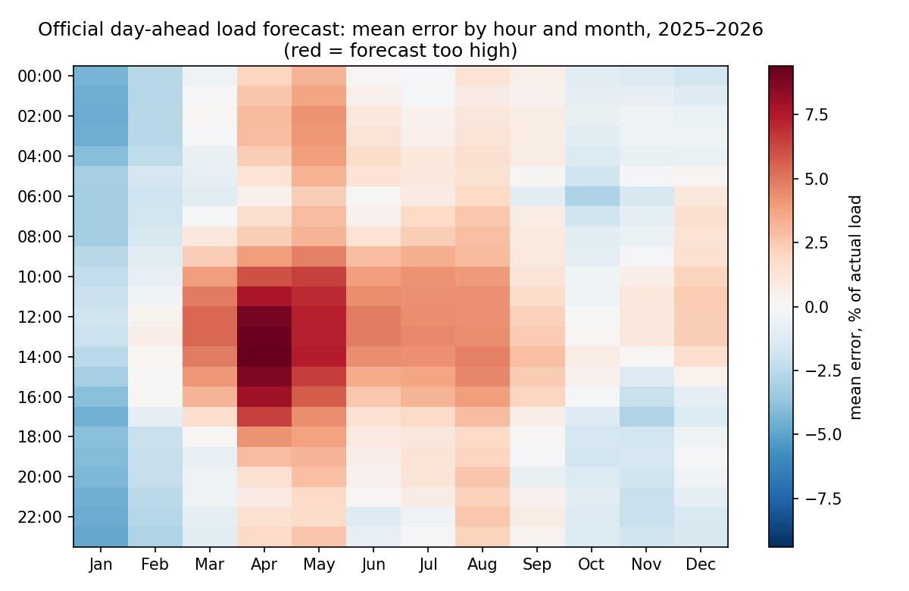
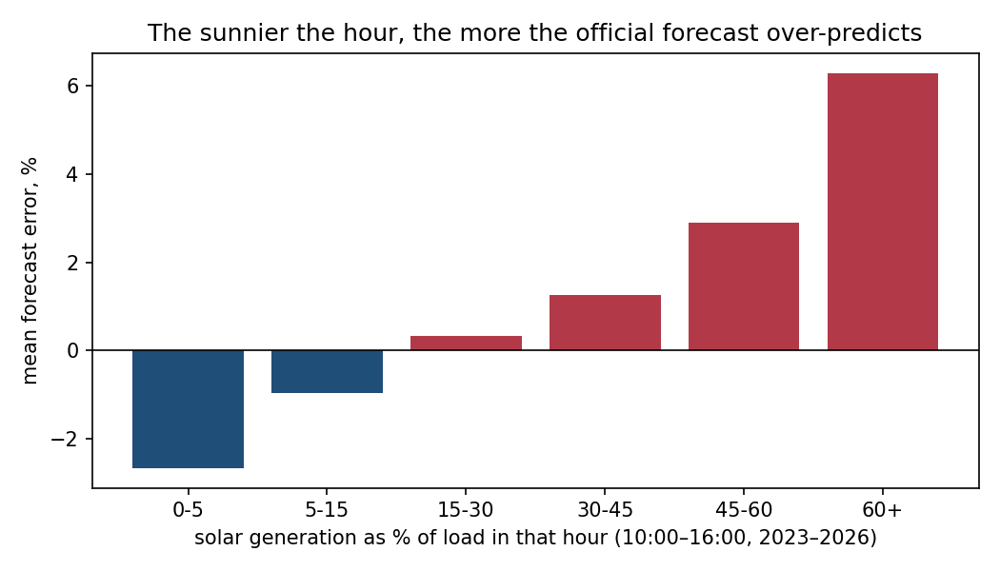
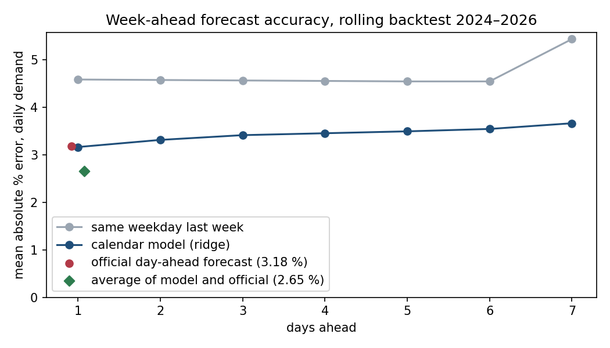

# German electricity demand: auditing the official forecast and forecasting the week ahead

Two questions a demand planner at a utility or trading desk would ask, answered on public German
grid data (SMARD, Bundesnetzagentur):

1. **How good is the official day-ahead load forecast, and where does it go wrong?**
2. **Can a simple, explainable model forecast daily demand for the next seven days, and does it add
   anything to the official forecast?**

Data: realised grid load (SMARD 410) and the official forecast for the following day (SMARD 411,
published by 10:00 the day before, source ENTSO-E), hourly from January 2023 and daily from January
2015, plus realised solar generation (SMARD 4068). Through 18 October 2026.
Source: **Bundesnetzagentur | SMARD.de**, CC BY 4.0.

## Findings

### 1. The official forecast over-predicts on sunny middays and under-predicts in winter



Its daily error is steady at about 3.2 % (hourly about 3.7–3.9 %), but the errors are not random.
In 2025–2026 it was too high by up to **9.4 % at 14:00 in April** and too low by up to 4.8 % on
January nights.



Between 10:00 and 16:00, the error rises steadily with the share of solar generation in that hour:
from −2.7 % when solar is under 5 % of load to **+6.3 % when it is over 60 %** (8,322 hours,
correlation 0.60). A likely reason, not proven here: rooftop solar used on site lowers the load the
grid sees, and the forecast does not fully account for it.

### 2. Correcting it with last year's pattern helps only some years

Dividing each hourly forecast by last year's average error for the same hour and month (only
cells where that error was at least 3 %, a rule fixed before testing):

| Year | Official, daily % error | Corrected |
|---|---:|---:|
| 2024 | 3.17 | 3.58 (worse) |
| 2025 | 3.15 | 3.05 |
| 2026 (to 18 Oct) | 3.24 | 2.65 |

The midday spring-summer cells improve every year (5.36 % → 4.00 % on those hours), but the rest of
last year's pattern does not repeat, and in 2024 it made things worse. The stable part is the solar
effect, so a durable correction should use tomorrow's solar forecast, not last year's calendar.

### 3. A calendar model matches the official forecast a day ahead, and averaging the two beats both



Rolling backtest, one forecast every morning from 2 January 2024 to 18 October 2026 (1,021 days),
each model refitted every 28 days on the previous three years only:

| Daily demand, mean absolute % error | 1 day ahead | 7 days ahead |
|---|---:|---:|
| Same weekday last week | 4.58 | 5.43 |
| Calendar model (ridge regression) | 3.16 | 3.66 |
| Official day-ahead forecast | 3.18 | not published |
| **Average of calendar model and official** | **2.65** | – |

- The calendar model and the official forecast are **statistically level** one day ahead (difference
  0.02 points, paired t-test p = 0.86), even though the model uses no weather data.
- **Averaging them** cuts the error to 2.65 %, better than the official forecast on 62.8 % of days
  (p < 0.0001): the two make different mistakes.
- On public holidays, bridge days and Christmas, "same weekday last week" misses by 18.6 % on average;
  the calendar model by 6.7 %.

### What a planner gets

[`reports/demand_forecast_planner.xlsx`](reports/demand_forecast_planner.xlsx): the next seven days
with an 80 % interval (from the backtest's own errors) and a chart; accuracy by model and horizon; the
day-ahead backtest with Excel formulas for every error, so the numbers can be checked in the sheet;
and the official forecast's bias table with colour scale.

## Method

| Step | File |
|---|---|
| Download SMARD series 410, 411, 4068 | [`src/demand/fetch.py`](src/demand/fetch.py) |
| German holidays (Easter rule, national and regional), bridge days, season terms | [`src/demand/calendar.py`](src/demand/calendar.py) |
| Official forecast audit and correction | [`src/demand/official.py`](src/demand/official.py) |
| Week-ahead models and rolling backtest | [`src/demand/weekahead.py`](src/demand/weekahead.py) |
| Tables, figures, results.json, Excel workbook | [`src/demand/report.py`](src/demand/report.py) |
| Tests: holiday rules, no-lookahead checks, correction uses only the prior year | [`tests/`](tests/) |

Choices worth defending:

- **The forecast is made on the morning of day t with data through day t−1**, the same timing as the
  official forecast, so the day-ahead comparison is fair. A test checks every feature against that rule.
- **The model predicts the ratio to the last seven days' average**, not the level. Demand fell from about
  505 TWh a year (2015–2021) to about 465 TWh (2023–2025); a ratio model adapts to such a shift within a week.
- **Three-year training window, refitted every 28 days**, so the model only learns from the recent regime.
- **Equal-weight averaging** of model and official forecast: nothing is fitted, so it cannot overfit the test.
- **One correction rule, fixed before testing, reported even where it lost.**

## Limits

- No weather data. Temperature and solar forecasts would help both the model and the correction.
- The official forecast is published only one day ahead, so beyond day 1 the model is compared with a
  naive baseline only.
- The solar explanation is supported by the data (correlation 0.60) but not proven; behind-the-meter
  solar is not measured directly.
- The Excel workbook was generated and checked with Python; its formulas calculate when it is opened in Excel.

## Run it

```bash
python -m venv .venv && source .venv/bin/activate
pip install -r requirements.txt && pip install -e .
python -m demand.fetch     # ~3 minutes, SMARD API
python -m demand.report    # every table, figure, results.json and the workbook, ~15 s
python -m pytest -q        # 9 tests
```

Built with SMARD data under CC BY 4.0 (Bundesnetzagentur | SMARD.de). Designed and reviewed by me,
written with an AI coding assistant (Claude Code); every figure here traces to
[`reports/results.json`](reports/results.json) and the CSVs in [`reports/tables/`](reports/tables/).
